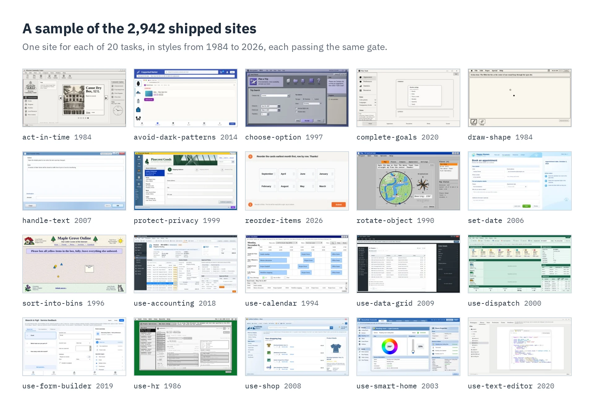
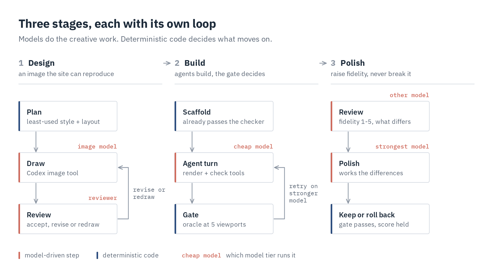
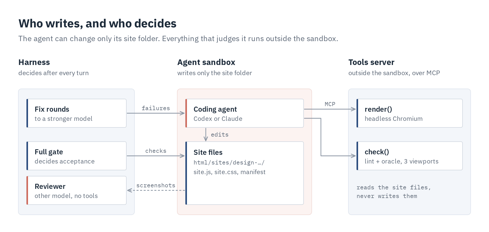

# megawob-harness

[](https://github.com/d-nyamkhuu/megawob-harness/actions/workflows/ci.yml)


**A website factory: AI agents build, automated checks decide. 2,942 shipped.**

It draws a design image for a web task, has a coding agent (Codex or Claude) rebuild it as a working site, and
accepts the site only when deterministic checks pass. It produced every `design-*` site in
[MegaWoB](https://github.com/d-nyamkhuu/megawob), a benchmark of seeded web tasks for training computer-use agents:
each site is a playable task with seeded content, randomized episode settings and an oracle solver.

[How it works](#how-it-works) · [The gate](#the-gate) · [What makes it reliable](#what-makes-it-reliable) ·
[Architecture](#architecture) · [Quick start](#quick-start) · [Repository layout](#repository-layout)



## The problem

Coding agents are unreliable workers. Asked to rebuild a design, they say "done" on a broken page, stop at the time
limit with half a site, test with something weaker than the real checker, and grade their own work 4 of 5. On the
first sites built for MegaWoB, agents that stopped early and graded themselves failed the independent review **4
times in 6**.

At 2,942 sites, every failure that needs a person is too many. So the pipeline treats the agent as an untrusted
worker inside a deterministic loop: it starts from something that works, it is checked by code it cannot influence,
and what it cannot fix goes to a stronger model.

## How it works



1. **Design.** Each design gets the era style its task has used least, a window arrangement the task has not used yet,
   a task-area layout from the task's capability card, and a real goal sampled from the environment. Codex's image
   tool draws it at 1536x864; a separate turn reviews it against a checklist and accepts, edits or redraws it.
2. **Build.** The site is scaffolded from MegaWoB's base site, so it passes the checker before the agent touches it.
   A cheap model restyles it to the image with two tools. `render` shows the page beside the design image, a crop,
   the small viewports, or the four instruction modes below, and can replay the oracle's first N actions to show
   where a check fails mid-episode. `check` runs a quick subset of the gate. The full gate runs after every turn,
   and its failures go back to the same thread on a stronger model.
3. **Polish.** A reviewer that never saw the build scores the page and lists the differences. The strongest model
   works through them in a fresh thread; the result is kept only if the gate still passes and the score held.


### The gate

Whatever the agent reports, nothing is accepted until this passes. Because the agent's own `check()` runs a subset of
it, most failures surface inside the agent's turn, not after it.


### One task, four designs

Designs of the same task differ in structure, not only in colour: four of the sites for the `use-email` task's
`archive` scenario, with the same goal.


## What makes it reliable

| Failure mode | What the pipeline does |
|---|---|
| The agent says "done" on a broken page | Its report is recorded, never trusted; only [the gate](#the-gate) accepts a site |
| The agent breaks the page, or stops at the time limit | Every build starts from a scaffold that already passes the checker. The time limit interrupts the turn and keeps its work, rather than killing it |
| The build model cannot fix what the gate finds | Fix rounds send the exact failures back to the same thread, on a stronger model, at most `--fix-rounds` times |
| A design shows something the site can never do | Each task's capability card lists what it renders at the start of each scenario and what it never shows; the image prompt and a separate image review enforce it |
| All designs of a task look alike | Style, window arrangement and task-area layout are allocated: the least used style, an unused arrangement, layouts in turn |
| The agent grades its own work | A reviewer on another model, with no tools, scores the page against the image |
| A polish makes the site worse | A polish is kept only if the gate still passes and the review score did not drop; otherwise the files are restored |
| The agent writes outside its site, or sees the operator's tools | Each runtime is sandboxed to the site folder and starts with none of the user's settings ([Architecture](#architecture)) |
| A long batch stops at one bad design, or dies halfway | A design's error is reported and the rest go on; every stage is resumable from files on disk (`new --pending` picks up undrawn designs, unbuilt ones and builds that stopped on an error); the shared scenario index is updated under a lock |
| Nobody knows what a build cost | Every turn's model, time, tokens, cost, tool calls, report and gate result go to a JSON run record |

## Architecture



- **Runtimes behind one interface.** A `Session` is a multi-turn agent in one workspace that can switch models
  between turns; `ask` is one JSON answer from a read-only turn; `image` draws one picture. Codex goes through its
  app-server SDK over JSON-RPC, Claude through the Claude Agent SDK, and a replay runtime scripts the agent's moves
  for tests.
- **Sandboxed and isolated.** Codex runs in its workspace-write sandbox with approvals denied, in a throwaway home
  that holds only the user's login. Claude gets file tools and no shell, and a `PreToolUse` hook denies writes
  outside the folder. The reviewer has no tools at all. Neither runtime loads the user's settings, instructions,
  plugins or MCP servers, so a build depends only on its brief and its tools.

## Quick start

It builds into a MegaWoB checkout, so install that checkout first (its README has the details). You also need Node 22
or later.

```bash
pip install -e path/to/megawob    # your MegaWoB checkout
pip install -e .                  # this repo (with Playwright)
playwright install chromium
codex login                       # Codex: builds, reviews, design images
claude login                      # Claude builds (--runtime claude), or set ANTHROPIC_API_KEY
```

It runs from any folder: designs, run records and logs go to `data/sitegen/` in the MegaWoB checkout (`--out`
changes that).

```bash
megawob-harness new use-email archive               # one new design image, then its site
megawob-harness design use-email archive --count 3  # only design images (reviewed)
megawob-harness build design-use-email-archive-07   # the site of a design drawn earlier
megawob-harness card use-email                      # rebuild a task's capability card
megawob-harness status                              # every design and build, then a summary
```

Batches plan everything in one process, so each design's style and layout account for the rest of the batch, then
draw and build `--jobs` designs at a time. A site is built as soon as its image is accepted, one design's error does
not stop the others, and the output also goes to `data/sitegen/logs/`:

```bash
megawob-harness card my-task && megawob-harness new my-task --count 3 --jobs 4  # a new task: 3 designs per scenario
megawob-harness new --all --dry-run         # what one more design per scenario would be; writes nothing
megawob-harness new --all --jobs 8          # one more design for every task and scenario (434 today)
megawob-harness new --pending --jobs 8      # resume: undrawn designs, unbuilt ones, builds that errored
```

Ctrl-C starts no new design and waits for the running ones to stop; a second Ctrl-C quits at once. A turn that does
not stop within two minutes of its time limit is abandoned, so a worker never waits forever.

**Sizing `--jobs`:** plan on about 1 GB of memory per job. Measured per job: the agent's process (~0.2 GB, more over
a long session), its tools server (~0.1 GB), and at its peak a render (~0.3 GB) or a checker run (~0.4 GB), each in a
child process that frees its memory when it ends. A batch warns when `--jobs` is more than the free memory allows.

<details>
<summary><b>What a build prints and records</b></summary>

One build with a 20-minute limit and no polish, so the review score is low. The cheap model's turn left a control
the oracle must click below the smallest viewport; the gate sent the exact failures back, and the fix model passed in
one more turn:

```text
design-fill-form-invoice-13: PASSED in 7.8 min (2 turns), review fidelity 2; record data/sitegen/runs/design-fill-form-invoice-13.json
```

Its run record, trimmed:

```json
{
  "site": "design-fill-form-invoice-13",
  "builder": "codex:gpt-6-luna", "fixer": "gpt-6.1-terra", "reviewer": "codex:gpt-6.1-sol",
  "turns": [
    {"stage": "build", "model": "gpt-6-luna", "seconds": 222.8, "tool_calls": {"render": 7, "check": 4},
     "gate": ["megawob.check 1024x640: seed 2003 scenario invoice {'popups': 'cookie', 'popupAt': 0}: oracle failed (done False, error 0.8333, tau 0, violations [], 11 actions); stuck: click at 195,712 repeated 11x without effect, the point hits nothing (outside the viewport)", "... 16 more"]},
    {"stage": "build fix", "model": "gpt-6.1-terra", "seconds": 173.3, "tool_calls": {"render": 6, "check": 5},
     "gate": []}
  ],
  "passed": true, "fidelity": 2, "minutes": 7.8
}
```

</details>

<details>
<summary><b>Stages and outputs</b></summary>

| Stage | Output |
|---|---|
| `card <task>...` | `megawob_harness/cards/<task>.json`: what the task renders at the start of each scenario, what it never renders, 2-4 ways to lay out the task area |
| `design <task> [<scenario>...]`, `design --all` or `design --pending` | `<out>/designs/<task>/<scenario>/<NN>/`: `design.json`, `prompt.txt`, `attempt-*.png`, `design.png` |
| `build <design.json or site>...` or `build --pending` | `html/sites/design-<task>-<scenario>-<NN>/`, `<out>/runs/<site>.json` |
| `new <task> [<scenario>...]`, `new --all` or `new --pending` | design, then build each design as soon as it is accepted |

`<out>` is `data/sitegen/` in the MegaWoB checkout unless `--out` says otherwise; each batch's log goes to
`<out>/logs/`. Without scenarios, `design` and `new` cover every scenario
of the task; `--count N` makes N designs per scenario; `--jobs N` runs N designs at a time.

</details>

<details>
<summary><b>Models and options</b></summary>

| Option | Default | Used for |
|---|---|---|
| `--runtime` | codex | builds, fix rounds and polish (`codex` or `claude`; set the models to match) |
| `--review-runtime` | codex | design and site reviews, capability cards |
| `--model` | gpt-6-luna | the build turn |
| `--fix-model` | gpt-6.1-terra | fix rounds (same thread, model switched) |
| `--polish-model` | gpt-6.1-sol | the polish pass (`--no-polish` skips it) |
| `--review-model` | gpt-6.1-sol | reviews and cards |
| `--image-model` | gpt-6-luna | relays the prompt to Codex's image tool |
| `--minutes` | 60 | the first turn's time limit (fix rounds get half) |
| `--fix-rounds` | 2 | gate failures sent back at most this often |

</details>

## Tests

```bash
pytest -m "not megawob"            # runtime config, isolation, write guard, JSON, batch selection: seconds
pytest -m megawob                  # the pipeline on a real site with a scripted agent: ~3 minutes
```

CI runs the lint and both suites on every push to main and every pull request.

<details>
<summary><b>What the pipeline tests cover</b></summary>

The `megawob` tests scaffold a stand-in site in the MegaWoB checkout, run the real gate and remove the site again:

- a checked build passing in one turn;
- a first turn that is not done going back as a fix round, even though the scaffold passes;
- a broken `site.js` going back to the fix model;
- a polish that the reviewer scores lower being rolled back.

</details>

## Repository layout

```text
megawob_harness/
├── cli.py            command line: card, design, build, new, status
├── designs.py        capability cards, design planning, image drawing and review
├── build.py          scaffold, agent threads, gate and fix rounds, review, polish, run record
├── gate.py           the deterministic gate: files, node --check, megawob.lint, megawob.check
├── tools.py          the agent's render and check tools, served over MCP
├── render.py         headless Chromium shots, side by side with the design image
├── jsonio.py         prompt templates, JSON answers, atomic writes
├── runtime/          one interface, three adapters
│   ├── base.py         Session (multi-turn agent) and Runtime (sessions, JSON answers, images)
│   ├── codex.py        Codex app-server SDK, sandbox, isolated home
│   ├── claude.py       Claude Agent SDK, write guard
│   └── replay.py       scripted agent for tests
├── prompts/          the build brief, image prompt, review checklists, report schema
├── cards/            59 capability cards, one per task
├── styles.json       74 era and visual-language profiles
└── arrangements.json window arrangement axes
docs/figures.py       regenerates the diagrams and screenshots in this README
```

| To change | Edit |
|---|---|
| Guidance for one scenario | its `hint` or `never` list in `cards/<task>.json` |
| Add a task | run `megawob-harness card <task>`, and add a widget template in MegaWoB |
| More styles or window layouts | `styles.json`, `arrangements.json` |
| What the agents are told | `prompts/` |

## License

MIT
