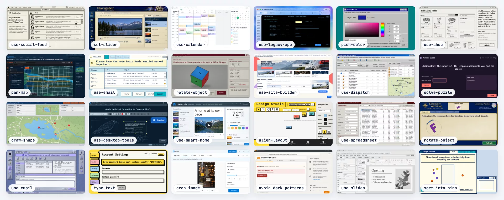
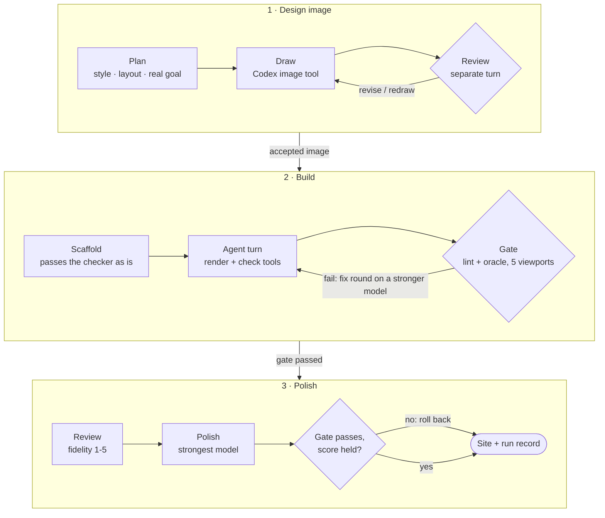
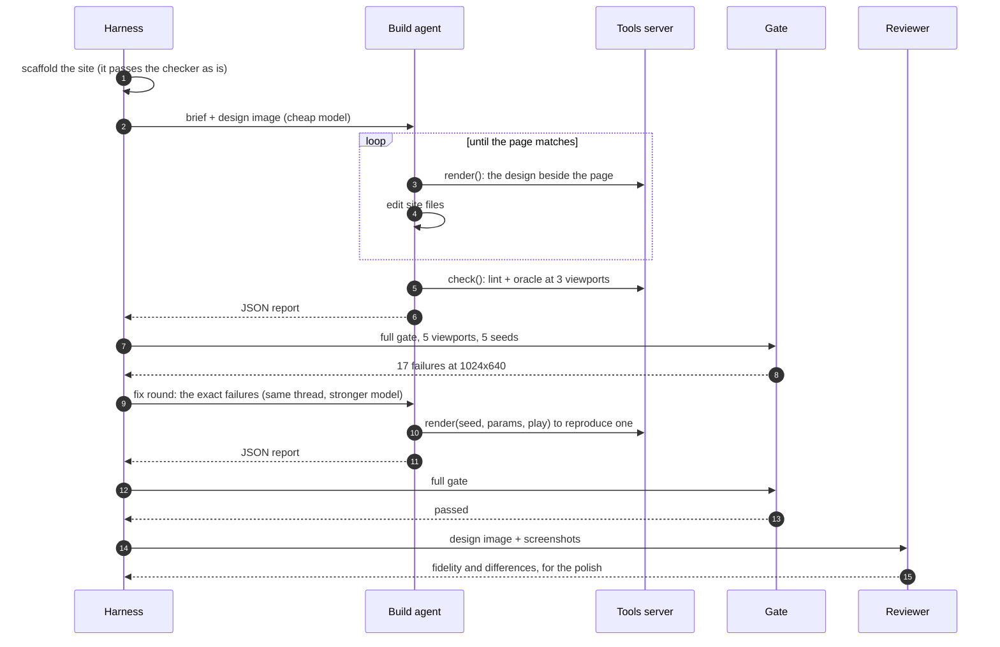
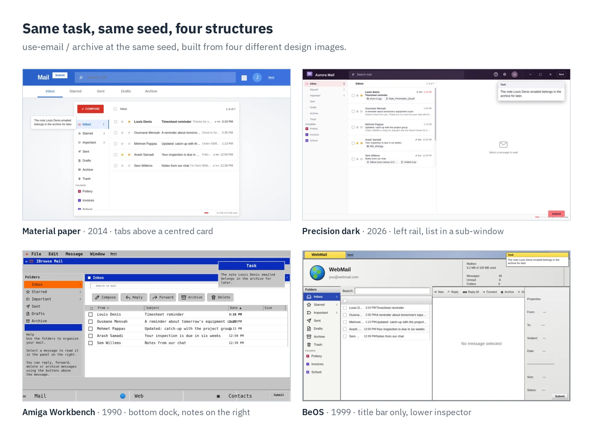
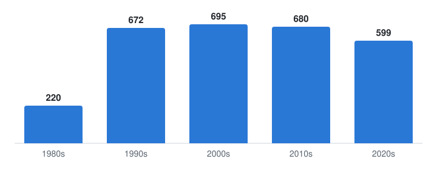
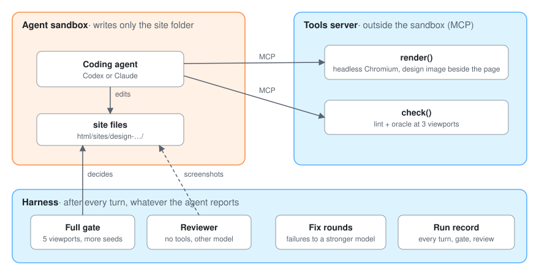
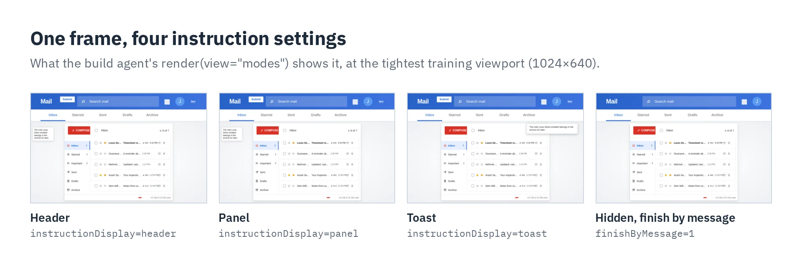
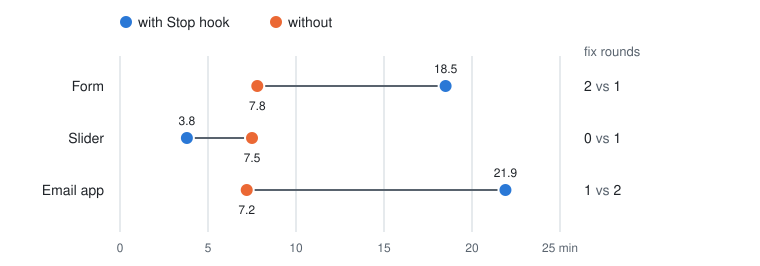

# megawob-harness

[](https://github.com/d-nyamkhuu/megawob-harness/actions/workflows/ci.yml)


**A website factory: AI agents build, automated checks decide. 2,942 shipped.**

It draws a design image for a web task, has a coding agent (Codex or Claude) rebuild it as a working site, and
accepts the site only when deterministic checks pass. It produced every `design-*` site in
[MegaWoB](https://github.com/d-nyamkhuu/megawob), a benchmark of seeded web tasks for training computer-use agents.



<sub>24 of the sites. Each one is a playable task with seeded content, randomized episode settings and an oracle
solver.</sub>

## At a glance

| Scale | What it means |
|---|---|
| **2,942** sites built | each its own design, rebuilt from its own generated image |
| **59** tasks, **434** task/scenario pairs | email, spreadsheets, maps, drawing, phishing traps, dark patterns, ... |
| **74** era styles × **144** window layouts | from a 1984 Lisa workstation to 2026 interfaces, allocated so a task's designs differ in structure |
| **5** viewports × every seed parameter | what the gate plays on each site before it is accepted |
| **0** sites accepted on an agent's word | a deterministic gate decides every build |
| **2** agent runtimes, one interface | Codex app-server (JSON-RPC) and the Claude Agent SDK |
| **~1,600** lines of Python | 11 modules, 11 tests, no agent framework |

**Skills on show:** architecture of an agent pipeline at scale, deterministic verification of LLM output, multi-model
orchestration and cost tiering, sandboxing and isolation, MCP tool servers, headless-browser rendering, testing
non-deterministic agents deterministically, and measuring design decisions (including one I
[measured and removed](#measured-and-removed-the-stop-hook)).

## The problem

Coding agents are unreliable workers. Asked to rebuild a design, they say "done" on a broken page, stop at the time
limit with half a site, test with something weaker than the real checker, and grade their own work 4 of 5. On the
first sites built for MegaWoB, agents that stopped early and graded themselves failed the independent review **4
times in 6**.

At 2,942 sites, every failure that needs a person is too many. So the pipeline treats the agent as an untrusted
worker inside a deterministic loop: it starts from something that works, it is checked by code it cannot influence,
and what it cannot fix goes to a stronger model.

## What makes it reliable

| Failure mode | What the pipeline does |
|---|---|
| The agent says "done" on a broken page | Its report never accepts anything. After every turn the gate runs the site's files, `node --check`, `megawob.lint` and the task's oracle, which plays every seed and randomization parameter, at all 5 training viewports |
| The agent breaks the page, or stops at the time limit | Every build starts from a scaffold that already passes the checker. The time limit interrupts the turn and keeps its work, rather than killing it |
| The build model cannot fix what the gate finds | Fix rounds send the exact failures back to the same thread, on a stronger model, at most `--fix-rounds` times |
| A design shows something the site can never do | Each task's capability card lists what it renders at the start of each scenario and what it never shows; the image prompt and a separate image review enforce it |
| All designs of a task look alike | Style, window arrangement and task-area layout are allocated: the least used style, an unused arrangement, layouts in turn |
| The agent grades its own work | A reviewer on another model, with no tools, scores the page against the image |
| A polish makes the site worse | A polish is kept only if the gate still passes and the review score did not drop; otherwise the files are restored |
| The agent writes outside its site, or sees the operator's tools | Codex runs in its workspace-write sandbox, Claude gets file tools, a write guard and no shell; both start with none of the user's settings |
| A long batch dies halfway | Every stage is resumable from files on disk; builds run in parallel (`--jobs`); the shared scenario index is updated under a lock |
| Nobody knows what a build cost | Every turn's model, time, tokens, cost, tool calls, report and gate result go to a JSON run record |

## How it works



1. **Design.** Each design gets the era style its task has used least, a window arrangement the task has not used yet,
   a task-area layout from the task's capability card, and a real goal sampled from the environment. Codex's image
   tool draws it at 1536x864; a separate turn reviews it against a checklist and accepts, edits or redraws it.
2. **Build.** The site is scaffolded from MegaWoB's base site, so it passes the checker before the agent touches it.
   A cheap model restyles it to the image with two tools, `render` and `check`, and the full gate runs after every
   turn. Failures go back to the same thread on a stronger model.
3. **Polish.** A reviewer that never saw the build scores the page and lists the differences. The strongest model
   works through them in a fresh thread; the result is kept only if the gate still passes and the score held.

### One build, end to end

A typical build: the cheap model gets the page close, the gate finds what it missed at a small viewport, and the fix
model clears it in a minute or two.



### One task, four designs

Designs of the same task differ in structure, not only in colour. Here are four of the sites for the `use-email`
task's `archive` scenario, at the same seed and with the same goal:



Across the whole set, the styles span four decades of interface design:

<picture>
  <source media="(prefers-color-scheme: dark)" srcset="docs/media/sites-by-era-dark.svg">
  
</picture>

<sub>Sites by the decade of their style profile (2,866 of the 2,942 record it in their name). The 1980s are fewer
because the style list starts in 1984.</sub>

## Architecture

The agent can write only its site folder. Everything that judges it runs outside its reach, and nothing the agent
says can get a site accepted:

<picture>
  <source media="(prefers-color-scheme: dark)" srcset="docs/media/trust-boundaries-dark.svg">
  
</picture>

- **Runtimes behind one interface.** A `Session` is a multi-turn agent in one workspace that can switch models
  between turns; `ask` is one JSON answer from a read-only turn; `image` draws one picture. Codex goes through its
  app-server SDK over JSON-RPC, Claude through the Claude Agent SDK, and a replay runtime scripts the agent's moves
  for tests.
- **Codex** runs in its workspace-write sandbox with approvals denied, in a throwaway home that holds only the
  user's login. **Claude** gets file tools and no shell, a `PreToolUse` hook denies writes outside the folder, and
  no user settings load. **The reviewer** has no tools at all.
- **Cost tiering.** A cheap model does the long build, a mid-size one fixes what the gate finds, and a strong one
  polishes and reviews, each set per stage.

### What the agent sees

`render` shows the design image beside the page, crops, the small viewports, or the four instruction modes every
site must handle. It can also replay the oracle's first N actions, to show where a check fails mid-episode:



## Measured and removed: the Stop hook

The pipeline used to make the agent verify its own work: a Stop hook refused to end the agent's turn until its own
`check()` had passed on its final files, and its report had to carry a token proving it. I tested whether that saved
work on full builds: three new designs, each built twice by Codex with the same models and budgets, with the hook
and without it.

<picture>
  <source media="(prefers-color-scheme: dark)" srcset="docs/media/stop-gate-minutes-dark.svg">
  
</picture>

| 3 builds each | With Stop hook | Without |
|---|---|---|
| Fix rounds | 3 | 4 |
| Minutes to an accepted site | 44.2 | **22.5** |
| Tokens (build threads) | 16.1 M | **6.4 M** |

The hook made the agent honest, but not more capable. When the cheap model could not make its checks pass, the hook
kept it grinding (13 and 22 checks), while without the hook the gate escalated the same failures to the stronger fix
model, which cleared them in one to three minutes. With model tiering an early stop is cheap, so the hook, its
ledger and its token were removed: about 250 lines, and one less thing to explain.

The experiment also found that Codex build agents could see the user's own Codex config, plugins and MCP servers;
every Codex process now runs in an isolated home. Three pairs are a small sample, and the
[decision record](experiments/stop-gate/README.md) has the full run records, per-run explanations and screenshots.

### Live checks

`tests/test_live.py` runs the pipeline on the real runtimes: a real Codex or Claude agent gets a scaffolded site,
drives the tools server, and must pass the gate in one turn. The first live runs found two bugs that the scripted
tests had missed:

- Both SDKs start MCP servers in the agent's working directory, which broke relative paths. The tools server now
  takes absolute paths from its spec.
- Playwright's sync API is bound to one thread. The tools server now runs all browser work on one worker thread, off
  the MCP event loop.

## Engineering notes

- **The gate is the only judge.** The agent's JSON report is recorded, never trusted. The one exception is a first
  turn that says it is not done: because the scaffold already passes, that turn goes back as a fix round.
- **JSON answers without strict output schemas.** Some reasoning models stalled after their reasoning item when given
  a strict schema, so the schema goes in the prompt and is validated locally, with a retry.
- **Testing agents without models.** A replay runtime scripts the agent's moves as Python functions behind the same
  interface. The pipeline tests build a real site through the real gate, with no API key.
- **Isolation by default.** Neither runtime loads the user's settings, instructions, plugins or MCP servers, so a
  build depends only on its brief and its tools.
- **No agent framework.** The pipeline is a plain loop over files: a site folder and a run record per build.

## Quick start

It builds into a MegaWoB checkout, so install that checkout first (its README has the details). You also need Node 22
or later.

```bash
pip install -e path/to/megawob'[check]' && playwright install chromium
pip install -e .            # this repo
codex login                 # Codex: builds, reviews, design images
claude login                # Claude builds (--runtime claude), or set ANTHROPIC_API_KEY
```

Run every command from the root of the MegaWoB checkout:

```bash
megawob-harness new use-email archive               # one new design image, then its site
megawob-harness design use-email archive --count 3  # only design images (reviewed)
megawob-harness build data/sitegen/designs/use-email/archive/07/design.json
megawob-harness card use-email                      # rebuild a task's capability card
megawob-harness status
```

<details>
<summary><b>Stages and outputs</b></summary>

| Stage | Output |
|---|---|
| `card <task>...` | `megawob_harness/cards/<task>.json`: what the task renders at the start of each scenario, what it never renders, 2-4 ways to lay out the task area |
| `design <task> <scenario>` | `<out>/designs/<task>/<scenario>/<NN>/`: `design.json`, `prompt.txt`, `attempt-*.png`, `design.png` |
| `build <design.json or site>...` | `html/sites/design-<task>-<scenario>-<NN>/`, `<out>/runs/<site>.json` |
| `new <task> <scenario>` | design, then build every accepted design |

`<out>` is `data/sitegen/` unless `--out` says otherwise. `--jobs N` runs designs or builds in parallel.

</details>

<details>
<summary><b>Models and options</b></summary>

| Option | Default | Used for |
|---|---|---|
| `--runtime` | codex | builds, fix rounds and polish (`codex` or `claude`; set the models to match) |
| `--review-runtime` | codex | design and site reviews, capability cards |
| `--model` | gpt-6-luna | the build turn |
| `--fix-model` | gpt-6.1-terra | fix rounds (same thread, model switched) |
| `--polish-model` | gpt-6.1-sol | the polish pass (`--no-polish` skips it) |
| `--review-model` | gpt-6.1-sol | reviews and cards |
| `--image-model` | gpt-6-luna | relays the prompt to Codex's image tool |
| `--minutes` | 60 | the first turn's time limit (fix rounds get half) |
| `--fix-rounds` | 2 | gate failures sent back at most this often |

</details>

## Tests

```bash
pytest -m "not megawob"            # runtime config, isolation, write guard, JSON parsing: seconds, no model
pytest -m megawob                  # the pipeline on a real site with a scripted agent: ~3 minutes
HARNESS_LIVE=1 pytest tests/test_live.py   # the pipeline on real Codex and Claude agents
```

The `megawob` tests scaffold a stand-in site in the MegaWoB checkout, run the real gate and remove the site again.
They cover:

- a checked build passing in one turn;
- a first turn that is not done going back as a fix round, even though the scaffold passes;
- a broken `site.js` going back to the fix model;
- a polish that the reviewer scores lower being rolled back.

CI runs the lint and both suites on every push to main and every pull request.

## Repository layout

```text
megawob_harness/
├── cli.py            command line: card, design, build, new, status
├── designs.py        capability cards, design planning, image drawing and review
├── build.py          scaffold, agent threads, gate and fix rounds, review, polish, run record
├── gate.py           the deterministic gate: files, node --check, megawob.lint, megawob.check
├── tools.py          the agent's render and check tools, served over MCP
├── render.py         headless Chromium shots, side by side with the design image
├── jsonio.py         prompt templates, JSON answers, atomic writes
├── runtime/          one interface, three adapters
│   ├── base.py         Session (multi-turn agent) and Runtime (sessions, JSON answers, images)
│   ├── codex.py        Codex app-server SDK, sandbox, isolated home
│   ├── claude.py       Claude Agent SDK, write guard
│   └── replay.py       scripted agent for tests
├── prompts/          the build brief, image prompt, review checklists, report schema
├── cards/            59 capability cards, one per task
├── styles.json       74 era and visual-language profiles
└── arrangements.json window arrangement axes
docs/figures.py       regenerates the figures in this README from a MegaWoB checkout
experiments/          the Stop-hook measurement: run records, screenshots, decision record
```

**Changing the workflow:** guidance for one scenario goes in its `hint` or `never` list in `cards/<task>.json`; a new
task needs `megawob-harness card <task>` and a widget template in MegaWoB; more styles or layouts go in
`styles.json` and `arrangements.json`; the prompts are in `prompts/`.

## Background reading

- OpenAI, [Harness engineering](https://openai.com/index/harness-engineering) (February 2026)
- Anthropic, [Effective harnesses for long-running agents](https://www.anthropic.com/engineering/effective-harnesses-for-long-running-agents)
- [Harness Engineering: Anatomy, Architecture, and Evolution of Coding Agents](https://arxiv.org/abs/2609.00006)
- [Agentic Harness Engineering](https://arxiv.org/abs/2604.25850)

## License

MIT
