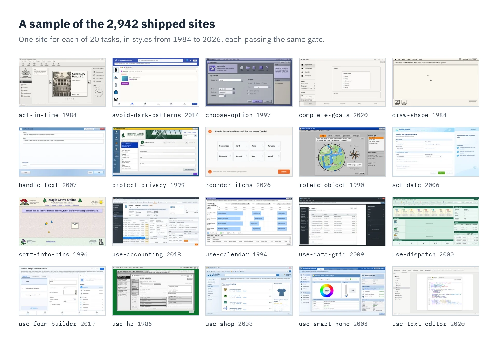
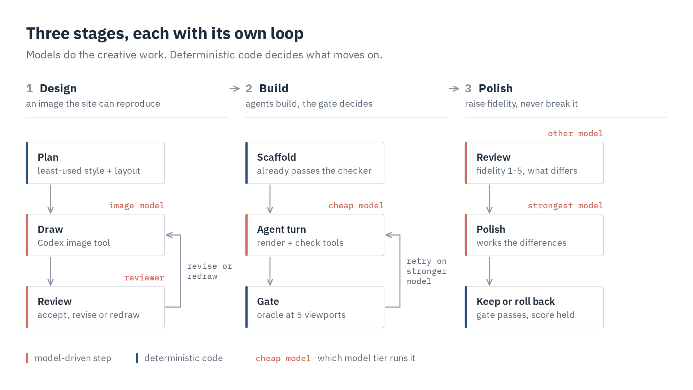
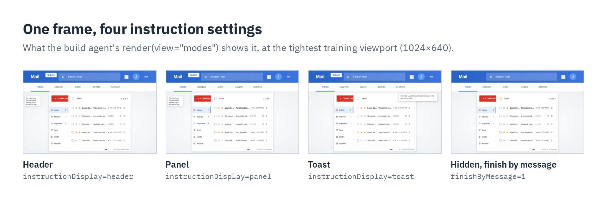
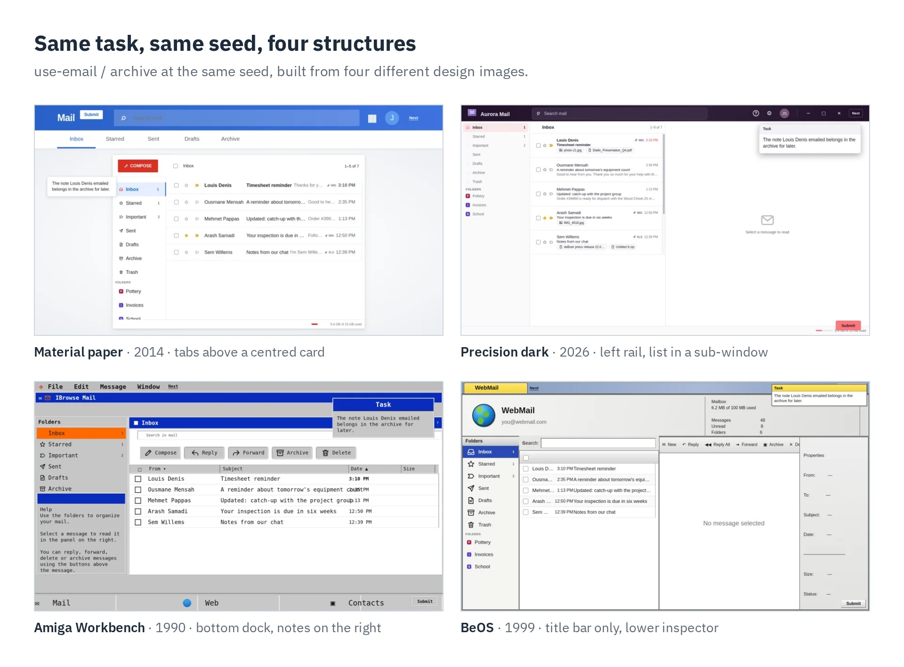
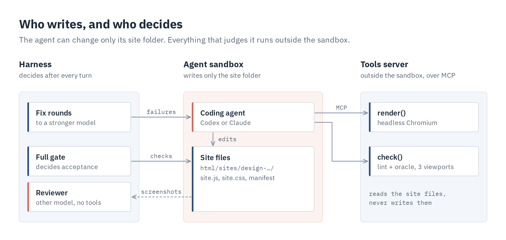

# megawob-harness

[](https://github.com/d-nyamkhuu/megawob-harness/actions/workflows/ci.yml)


**Agent harness that builds web environments for computer-use agents: Codex or Claude builds each site, deterministic checks decide. 2,942 sites shipped.**

It draws a design image for a web task, has a coding agent (Codex or Claude) rebuild it as a working site, and
accepts the site only when deterministic checks pass. It produced every `design-*` site in
[MegaWoB](https://github.com/d-nyamkhuu/megawob), a benchmark of seeded web tasks for training computer-use agents:
each site is a playable task with seeded content, randomized episode settings and an oracle solver.

[Features](#features) · [How it works](#how-it-works) · [What makes it reliable](#what-makes-it-reliable) ·
[Design decisions](#design-decisions) · [Architecture](#architecture) · [Quick start](#quick-start) ·
[Commands](#commands) · [Development](#development) · [Repository layout](#repository-layout)



## Features

- **Codex or Claude.** Either one builds, fixes and polishes, behind one runtime interface; a scripted replay
  runtime runs the pipeline in tests without a model.
- **Checks decide, not the agent.** A deterministic [gate](#the-gate) (files, syntax, lint, and the oracle at five
  viewports) accepts a site; the agent's own report is recorded and never trusted.
- **Model tiering.** A cheap model builds, a stronger one gets the gate's exact failures in the same thread, and the
  strongest polishes; a polish is kept only if the gate still passes and the review score held.
- **An independent reviewer.** Another model, with no tools, scores every design image and site.
- **Designs that differ.** Each design gets the era style its task has used least, a window arrangement it has not
  used, and a real goal sampled from the environment; capability cards keep the image to what the site can render.
- **Batches.** Plan once, then draw and build `--workers` designs in parallel; `--dry-run` shows the plan,
  `--resume` continues a stopped batch, Ctrl-C stops cleanly, and a warning comes when the workers would not fit in memory.
- **Sandboxed.** Each agent writes only in its site folder and loads none of the user's settings, instructions,
  plugins or MCP servers.
- **A record of every build.** Each turn's model, time, tokens, cost, tool calls, report and gate result.

## The problem

Coding agents are unreliable workers. Asked to rebuild a design, they say "done" on a broken page, stop at the time
limit with half a site, test with something weaker than the real checker, and grade their own work 4 of 5. On the
first sites built for MegaWoB, agents that stopped early and graded themselves failed the independent review **4
times in 6**.

At 2,942 sites, every failure that needs a person is too many. So the pipeline treats the agent as an untrusted
worker inside a deterministic loop: it starts from something that works, it is checked by code it cannot influence,
and what it cannot fix goes to a stronger model.

## How it works



1. **Design.** Each design gets the era style its task has used least, a window arrangement the task has not used yet,
   a task-area layout from the task's capability card, and a real goal sampled from the environment. Codex's image
   tool draws it at 1536x864; a separate turn reviews it against a checklist and accepts, edits or redraws it.
2. **Build.** The site is scaffolded from MegaWoB's base site, so it passes the checker before the agent touches it.
   A cheap model restyles it to the image with two tools. `render` shows the page beside the design image, a crop,
   the small viewports, or the four instruction modes below, and can replay the oracle's first N actions to show
   where a check fails mid-episode. `check` runs a quick subset of the gate. The full gate runs after every turn,
   and its failures go back to the same thread on a stronger model.
3. **Polish.** A reviewer that never saw the build scores the page and lists the differences. The strongest model
   works through them in a fresh thread; the result is kept only if the gate still passes and the score held.



### The gate

Whatever the agent reports, nothing is accepted until this passes. Because the agent's own `check()` runs a subset of
it, most failures surface inside the agent's turn, not after it.


### One task, four designs

Designs of the same task differ in structure, not only in colour: four of the sites for the `use-email` task's
`archive` scenario, with the same goal.



## What makes it reliable

| Failure mode | What the pipeline does |
|---|---|
| The agent says "done" on a broken page | Its report is recorded, never trusted; only [the gate](#the-gate) accepts a site |
| The agent breaks the page, or stops at the time limit | Every build starts from a scaffold that already passes the checker. The time limit interrupts the turn and keeps its work, rather than killing it |
| The build model cannot fix what the gate finds | Fix rounds send the exact failures back to the same thread, on a stronger model, at most `--fix-rounds` times |
| A design shows something the site can never do | Each task's capability card lists what it renders at the start of each scenario and what it never shows; the image prompt and a separate image review enforce it |
| All designs of a task look alike | Style, window arrangement and task-area layout are allocated: the least used style, an unused arrangement, layouts in turn |
| The agent grades its own work | A reviewer on another model, with no tools, scores the page against the image |
| A polish makes the site worse | A polish is kept only if the gate still passes and the review score did not drop; otherwise the files are restored |
| The agent writes outside its site, or sees the operator's tools | Each runtime is sandboxed to the site folder and starts with none of the user's settings ([Architecture](#architecture)) |
| A long batch stops at one bad design, or dies halfway | A design's error is reported and the rest go on; every stage is resumable from files on disk (`new --resume` picks up undrawn designs, unbuilt ones and builds that stopped on an error); the shared scenario index is updated under a lock |
| Nobody knows what a build cost | Every turn's model, time, tokens, cost, tool calls, report and gate result go to a JSON run record |

## Design decisions

### Tried and removed: a Stop hook

An earlier version made the agent verify its own work: a Stop hook refused to end the turn until the agent's own
`check()` had passed on its final files. It did not improve the sites. The small build model did call `check()`, but
when it could not fix what the check found, the hook kept sending it back, so it looped (13 checks in 13 minutes on
one design, 22 on another) and kept spending tokens. Without the hook the turn ends early and the gate sends the same
failures to the stronger fix model, which cleared them in one to three minutes. Three designs, each built once with
the hook and once without, on the same models and budgets:

| 3 builds each | With the Stop hook | Without |
|---|---|---|
| Minutes to an accepted site | 44.2 | **22.5** |
| Tokens (build threads) | 16.1 M | **6.4 M** |
| Fix rounds | 3 | 4 |

All six builds passed the gate in the end. The hook made the agent honest about failing checks, but not able to fix
them, and model tiering already makes an early stop cheap, so the hook was removed from the final design.

### Every browser runs in a process of its own

Renders, checks and goal sampling each start a child process with its own Chromium, in a process group of its own.
When it returns, the browser and all its memory are gone, and a browser that hangs is killed with its whole group at
a timeout. Starting a fresh browser makes each render take about 2 seconds; in exchange, a batch of thousands of
builds cannot slowly fill memory or wait forever on a stuck page.

### The answer schema goes in the prompt

Reviews and plans return JSON. The schema goes in the prompt and the answer is validated locally with a retry,
rather than passed to the providers' structured-output options: some reasoning models stall when given a strict
output schema, and local validation is just as strict for both runtimes.

## Architecture



- **Runtimes behind one interface.** A `Session` is a multi-turn agent in one workspace that can switch models
  between turns; `ask` is one JSON answer from a read-only turn; `image` draws one picture. Codex goes through its
  app-server SDK over JSON-RPC, Claude through the Claude Agent SDK, and a replay runtime scripts the agent's moves
  for tests.
- **Sandboxed and isolated.** Codex runs in its workspace-write sandbox, writable in the site folder only (not
  `/tmp`), with approvals denied, in a throwaway home that holds only the user's login. Claude gets file tools and no
  shell, and a permission rule allows writes in the folder only (every other write is denied). The reviewer has no
  tools at all. Neither runtime loads the user's settings, instructions, plugins or MCP servers, so a build depends
  only on its brief and its tools.

## Quick start

Requirements:

- [uv](https://docs.astral.sh/uv/), and Node 22 or later (uv installs Python 3.14 if you do not have it);
- Linux (CI runs Ubuntu 24.04); macOS should work, but the memory warning reads Linux's `/proc` and stays silent there;
- a Codex login for design images, reviews and Codex builds; a Claude login (or `ANTHROPIC_API_KEY`) only for
  `--runtime claude`;
- about 1 GB of memory per worker.

```bash
uv tool install --python 3.14 git+https://github.com/d-nyamkhuu/megawob-harness \
    --with git+https://github.com/d-nyamkhuu/megawob    # MegaWoB: about 550 MB, its pages come with it
uvx playwright@1.58.0 install chromium                  # the browser the checks run in
codex login                       # Codex: design images, reviews and builds
claude login                      # only for --runtime claude (or set ANTHROPIC_API_KEY)
```

`uv tool install` puts `megawob-harness` on your PATH, with MegaWoB in an environment of its own;
`uv tool upgrade megawob-harness` updates both. Everything the harness writes goes to `./sitegen/` in the folder
you run it from, finished sites included. Only changing its prompts or styles needs a clone of this repo
([Development](#development)).

Then:

```bash
megawob-harness new use-email archive    # draw one new design image for the archive scenario, then build its site
megawob-harness status                   # list every design and its site, then totals
```

## Commands

A **task** is one kind of web interaction in MegaWoB (`use-email`, `set-slider`, ...) and a **scenario** is one
variant of it (`use-email archive`). A **design** is a design image for one task and scenario; its **site** is the
working page an agent builds from it, named `design-<task>-<scenario>-<NN>`. Everything goes to `./sitegen/`
(`--out` changes that).

| Command | What it does | Where it writes |
|---|---|---|
| `new <task> [<scenario>...]` | Plans and draws a design image for each scenario (all of them if none are named), has another model review it, then builds the site of each accepted one | both of the rows below |
| `design <task> [<scenario>...]` | Only the design images, each reviewed (accepted, edited or redrawn, up to `--attempts` images) | `designs/<task>/<scenario>/<NN>/`: `design.png`, `design.json` (plan and verdict), every attempt |
| `build <site>...` | Builds the site of a design drawn earlier: an agent restyles a working base site to the image, then the checks decide and failures go back for fix turns | `sites/<site>/` (the finished site) and `runs/<site>.json` (its run record) |
| `status` | Lists every design (planned, accepted, rejected) and its site (not built, passed, failed, stopped on an error), then totals: pass rate, median minutes, review scores | prints only |
| `capabilities <task>...` | Once per new task: a model reads the task's code and writes down what it shows at the start of each scenario and what it never shows, so design images never ask for something the site cannot do | `cards/<task>.json`, used instead of the card installed with the package |

For `new` and `design`, `--count N` draws N designs per scenario and `--all` covers every scenario of every task.

**Adding the sites to MegaWoB.** A site is built inside the installed MegaWoB, where its checks run, and the
finished site is copied to `sitegen/sites/`; that copy is the one to keep, since reinstalling MegaWoB removes the
other. To add the sites to a MegaWoB checkout, copy them into its `html/sites/` and index them there:

```bash
cp -r sitegen/sites/design-* path/to/megawob/html/sites/
cd path/to/megawob && python -m megawob.scenarios --site 'design-*'   # in the checkout's own environment
```

### Batches

A batch is planned first, in one process, so each design's style and layout account for the rest of the batch; then
`--workers` designs are drawn and built at the same time. A site is built as soon as its image is accepted, one
design's error does not stop the others, and the output also goes to `sitegen/logs/`.

```bash
megawob-harness capabilities my-task && megawob-harness new my-task --count 3 --workers 4  # a new task, 3 per scenario
megawob-harness new --all --dry-run          # show the plan for one more design per scenario; change nothing
megawob-harness new --all --workers 8        # one more design for every task and scenario (434 today)
megawob-harness new --resume --workers 8     # continue a stopped batch: undrawn designs, unbuilt sites, failed builds
megawob-harness new --resume --dry-run       # show what --resume would do; change nothing
```

Ctrl-C starts no new design and waits for the running ones to stop; a second Ctrl-C quits at once. A turn that does
not stop within two minutes of its time limit is abandoned, so a worker never waits forever.

**Sizing `--workers`:** plan on about 1 GB of memory per worker. Measured per worker: the agent's process (~0.2 GB,
more over a long session), its tools server (~0.1 GB), and at its peak a render (~0.3 GB) or a checker run (~0.4 GB),
each in a child process that frees its memory when it ends. A batch warns when `--workers` is more than the free
memory allows.

<details>
<summary><b>What a build prints and records</b></summary>

One build with a 20-minute limit and no polish, so the review score is low. The cheap model's turn left a control
the oracle must click below the smallest viewport; the gate sent the exact failures back, and the fix model passed in
one more turn:

```text
design-fill-form-invoice-13: PASSED in 7.8 min (2 turns), review fidelity 2; record sitegen/runs/design-fill-form-invoice-13.json
```

Its run record, trimmed:

```json
{
  "site": "design-fill-form-invoice-13",
  "builder": "codex:gpt-6-luna", "fixer": "gpt-6.1-terra", "reviewer": "codex:gpt-6.1-sol",
  "turns": [
    {"stage": "build", "model": "gpt-6-luna", "seconds": 222.8, "tool_calls": {"render": 7, "check": 4},
     "gate": ["megawob.check 1024x640: seed 2003 scenario invoice {'popups': 'cookie', 'popupAt': 0}: oracle failed (done False, error 0.8333, tau 0, violations [], 11 actions); stuck: click at 195,712 repeated 11x without effect, the point hits nothing (outside the viewport)", "... 16 more"]},
    {"stage": "build fix", "model": "gpt-6.1-terra", "seconds": 173.3, "tool_calls": {"render": 6, "check": 5},
     "gate": []}
  ],
  "passed": true, "fidelity": 2, "minutes": 7.8
}
```

</details>

<details>
<summary><b>Models and options</b></summary>

| Option | Default | Used for |
|---|---|---|
| `--runtime` | codex | builds, fix rounds and polish (`codex` or `claude`; set the models to match) |
| `--review-runtime` | codex | design and site reviews, `capabilities` |
| `--model` | gpt-6-luna | the build turn |
| `--fix-model` | gpt-6.1-terra | fix rounds (same thread, model switched) |
| `--polish-model` | gpt-6.1-sol | the polish pass (`--no-polish` skips it) |
| `--review-model` | gpt-6.1-sol | reviews and `capabilities` |
| `--image-model` | gpt-6-luna | relays the prompt to Codex's image tool |
| `--minutes` | 60 | the first turn's time limit (fix rounds get half) |
| `--fix-rounds` | 2 | how many times failed checks go back to the agent |

</details>

## Development

A clone with a MegaWoB checkout inside it, the way CI sets it up; `uv run megawob-harness ...` then runs your
edits to the prompts, styles and code at once.

```bash
git clone https://github.com/d-nyamkhuu/megawob-harness && cd megawob-harness
git clone https://github.com/d-nyamkhuu/megawob
uv venv --python 3.14 && uv pip install -e ./megawob -e '.[dev]'
uv run playwright install chromium
```

Tests:

```bash
uv run pytest -m "not megawob"     # runtime config, isolation, write rule, JSON, batch selection: seconds
uv run pytest -m megawob           # the pipeline on a real site with a scripted agent: ~3 minutes
uv run ruff check megawob_harness tests
```

CI runs the lint and both suites on every push to main and every pull request.

<details>
<summary><b>What the pipeline tests cover</b></summary>

The `megawob` tests scaffold a stand-in site in the installed MegaWoB, run the real gate and remove the site again:

- a checked build passing in one turn;
- a first turn that is not done going back as a fix round, even though the scaffold passes;
- a broken `site.js` going back to the fix model;
- a polish that the reviewer scores lower being rolled back.

</details>

## Repository layout

```text
megawob_harness/
├── cli.py            command line: new, design, build, status, capabilities
├── designs.py        capability cards, design planning, image drawing and review
├── build.py          scaffold, agent threads, gate and fix rounds, review, polish, run record
├── gate.py           the deterministic gate: files, node --check, megawob.lint, megawob.check
├── tools.py          the agent's render and check tools, served over MCP
├── render.py         headless Chromium shots, side by side with the design image
├── jsonio.py         prompt templates, JSON answers, atomic writes
├── runtime/          one interface, three adapters
│   ├── base.py         Session (multi-turn agent) and Runtime (sessions, JSON answers, images)
│   ├── codex.py        Codex app-server SDK, sandbox, isolated home
│   ├── claude.py       Claude Agent SDK, write rule
│   └── replay.py       scripted agent for tests
├── prompts/          the build brief, image prompt, review checklists, report schema
├── cards/            59 capability cards, one per task
├── styles.json       74 era and visual-language profiles
└── arrangements.json window arrangement axes
docs/figures.py       regenerates the diagrams and screenshots in this README
```

| To change | Edit |
|---|---|
| Guidance for one scenario | its `hint` or `never` list in the task's card: copy it from `megawob_harness/cards/` to `sitegen/cards/` and edit it there |
| Add a task | run `megawob-harness capabilities <task>`, and add a widget template in MegaWoB |
| More styles or window layouts | `styles.json`, `arrangements.json` (in a clone) |
| What the agents are told | `prompts/` (in a clone) |

## License

MIT
